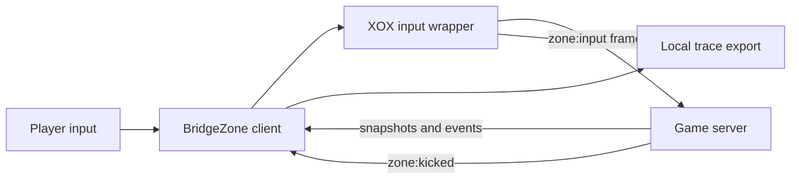

# Findings and evidence

This document records what the saved BridgeZone client traces show. It separates
local tests, browser-side observations, and events confirmed by the game server.
The results are from private bot matches on 2026-10-08 and 2026-10-15; they do
not establish behavior in every match or a general anti-cheat bypass.

## System boundary



The public client exposes input submission, prediction, rendering, snapshots,
and the handling of a `zone:kicked` event. The server decides whether to accept
shots or remove a player. Its detector and authoritative physics source were
not delivered to the browser and are not in this repository. The
[capture manifest](research/manifest.json) identifies the public client bundles
examined; the original third-party bundles remain excluded from this repository.

## Evidence index

Server counts below come from the saved `serverEvents` arrays, except for the
1.4.0 summary. A missing kick means none was recorded before that particular
trace ended, not that the server would never kick.

| Receipt | Version | Server events | Recorded outcome |
| --- | --- | --- | --- |
| [Summary](verification/live-result.json) | 1.4.0 | 11 shots, 4 hits, 54.6 damage | Removed for detected aim assistance; no raw event transcript |
| No JSON trace | 1.5.1 | Authoritative counters unavailable | Removed in a private 9-bot match; screenshot retained locally |
| [Trace](verification/live-trace-v1.5.3-2026-10-15.json) | 1.5.3 | 44 shots, 8 hits, 1 kill, 190.6 damage | `kicked`: aim assistance detected |
| [First trace](verification/live-trace-v1.5.4-2026-10-15.json) | 1.5.4 | 19 shots, 13 hits, 2 kills, 198.8 damage | No recorded kick before bot elimination |
| [Second trace](verification/live-trace-v1.5.4-active-2026-10-15.json) | 1.5.4 | 51 shots, 14 hits, 228.2 damage | No recorded kick before bot elimination |
| [Early export](verification/live-trace-v1.5.5-2026-10-15.json) and [later export](verification/live-trace-v1.5.5-25bots-2026-10-15.json) | 1.5.5 | 1 shot, 1 hit, 32 damage | Two snapshots of **one short match**, with no recorded kick |

The two 1.5.5 files share `trace.startedAt =
2026-10-15T14:33:31.561Z`, the same match counter, and the same two server
events. They must not be counted as independent trials. The first export contains
3,850 input frames and the later one contains the rolling maximum of 4,096.

### Integrity hashes

Use `shasum -a 256 verification/*.json` to compare downloaded receipts with
these SHA-256 values.

| File | SHA-256 |
| --- | --- |
| `live-trace-v1.5.3-2026-10-15.json` | `b1b3af3ffbae9e68f35b52bc183520f7e3bf142aa5bc1e4d5847a5e8d5b08a67` |
| `live-trace-v1.5.4-2026-10-15.json` | `d108d10fa95ed641231d28a50be32675afb03a6aa708834286a28e6849172371` |
| `live-trace-v1.5.4-active-2026-10-15.json` | `086b22e02bb463ada8dce29f2ebe501e5e313bfcf77fa2dedc433925f151aa69` |
| `live-trace-v1.5.5-2026-10-15.json` | `16b1d73a03af12b52e193c5e636a39a9ec84febf1822d76d160980d3dbdbde51` |
| `live-trace-v1.5.5-25bots-2026-10-15.json` | `5f19f7a7845711351b3040e0ede3f91ee868252a8a8f98857675f773870f7284` |

## What changed and what was observed

### Rejected aim behavior

The 1.4.0 summary recorded 11 server shots, 4 hits, and then removal. Version
1.5.1 displayed player and loot overlays in Edge but was also removed for
detected aim assistance; its authoritative counters were not saved. Version
1.5.3 has the strongest preserved rejection receipt: 44 server shots, 8 hits,
one kill, then a `kicked` connection state with the error:

> Anti-cheat removed you from this match: aim assistance was detected.

In the retained 1.5.3 input window, the original camera turned at most 14.6
degrees between adjacent frames while outgoing aim turned as far as 87.6 degrees.
Large outgoing turns often occurred on Fire and reversed on the next frame.
That is a plausible detection signal, **not proof** of the private server rule.

### Bounded turns and ammunition state

Version 1.5.4 capped outgoing turns at four degrees per input frame and held
Fire until the outgoing aim aligned. Two private 99-bot matches recorded server
hits without an anti-cheat kick before bot elimination. This is evidence of
bounded success, not of persistent acceptance or immunity to detection.

The second 1.5.4 trace contains 84 locally predicted shots but only 51
server-confirmed shots. Predictions continued after server confirmations stopped
while the client still reported a connected state. The prior local-only magazine
and reserve refill is a plausible cause of that divergence; it is not confirmed
as the server's reason. Version 1.5.5 removed that local ammo mutation and
requests a normal reload from available reserve ammo.

Version 1.5.5 raised the turn cap to eight degrees, favors targets requiring
less turning, and limits Rage fire to a weapon's useful range. Its saved match
ended too early to measure sustained accuracy or anti-cheat acceptance: the
server confirmed one shot and one hit. Local tests cover its input and prediction
paths, but no broader live conclusion follows from the short trace.

### Local display and movement limits

The client predicts a shot locally before an outgoing input frame may be
rewritten. A visible tracer can therefore follow the original camera while the
server receives a different aim angle. Server-confirmed shot and hit events are
the deciding evidence. Spread inversion is covered by a local single-projectile
test, but lag and reconciliation can change authoritative shot state. Shotgun
pellets cannot all be corrected with one direction, and cover can still block
shots.

Physical fly or underground hover is not implemented. The observed input frames
have no position or velocity setter, server snapshots restore authoritative
positions, and the shared raycaster rejects below-terrain shot origins. A real
new movement mode would require the owner's server and physics source.

## Reproduce the local checks

```sh
./extension/build-extension.sh
node --check bridgezone-tools.user.js
node --check extension/loader.js
node --check extension/bridgezone-main.js
node --test tests/*.test.cjs
```

The 2026-10-15 local run passed 50 tests with the captured public client archive
available. Three tests use that optional archive; in a fresh clone without it,
those three skip. The JSON trace files are exports of observed input frames,
local shot predictions, server events, and connection state. The trace is
bounded, contains no session token or match ID, and cannot reveal an unshipped
server detector. The panel's **Save trace** button exports the current in-memory
buffer; save it before leaving a match.

## Publication choices

All original project code and JSON findings are in XOX. The 39 captured
third-party JavaScript bundles are described by [URLs and hashes](research/manifest.json)
but are not republished. Raw PNG screenshots are also excluded because the
archive contains browser context and at least one private lobby invite URL.
Some older observations are therefore summarized without a public screenshot.
