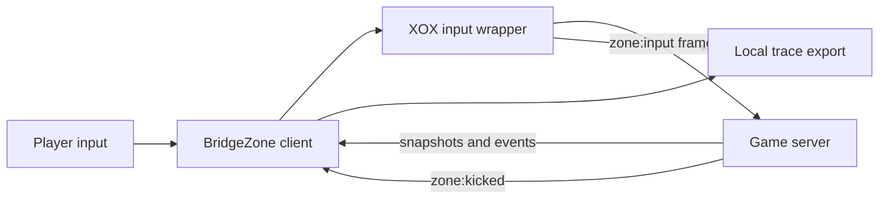

# Findings and evidence

This document records what the saved BridgeZone client traces show. It separates
local tests, browser-side observations, and events confirmed by the game server.
The results are from private bot matches on 2026-10-08 and 2026-10-15; they do
not establish behavior in every match or a general anti-cheat bypass.

## System boundary



The public client exposes input submission, prediction, rendering, snapshots,
and the handling of a `zone:kicked` event. The server decides whether to accept
shots or remove a player. Its detector and authoritative physics source were
not delivered to the browser and are not in this repository. The
[capture manifest](research/manifest.json) identifies the public client bundles
examined; the original third-party bundles remain excluded from this repository.

## Evidence index

Server counts below come from the saved `serverEvents` arrays, except for the
1.4.0 summary. A missing kick means none was recorded before that particular
trace ended, not that the server would never kick.

| Receipt | Version | Server events | Recorded outcome |
| --- | --- | --- | --- |
| [Summary](verification/live-result.json) | 1.4.0 | 11 shots, 4 hits, 54.6 damage | Removed for detected aim assistance; no raw event transcript |
| No JSON trace | 1.5.1 | Authoritative counters unavailable | Removed in a private 9-bot match; screenshot retained locally |
| [Trace](verification/live-trace-v1.5.3-2026-10-15.json) | 1.5.3 | 44 shots, 8 hits, 1 kill, 190.6 damage | `kicked`: aim assistance detected |
| [First trace](verification/live-trace-v1.5.4-2026-10-15.json) | 1.5.4 | 19 shots, 13 hits, 2 kills, 198.8 damage | No recorded kick before bot elimination |
| [Second trace](verification/live-trace-v1.5.4-active-2026-10-15.json) | 1.5.4 | 51 shots, 14 hits, 228.2 damage | No recorded kick before bot elimination |
| [Early export](verification/live-trace-v1.5.5-2026-10-15.json) and [later export](verification/live-trace-v1.5.5-25bots-2026-10-15.json) | 1.5.5 | 1 shot, 1 hit, 32 damage | Two snapshots of **one short match**, with no recorded kick |
| User-supplied export, not mirrored | 1.5.6 | 88 shots, 27 hits, 6 kills | Mixed weapons in one match; no recorded kick |
| User-supplied export, not mirrored | 1.5.8 | 0 shots, 0 hits | No outgoing Fire; 202 Rage samples held at alignment after ADS, no recorded kick |
| User-supplied export, not mirrored | 1.5.9 | 351 shots, 82 hits, 13 kills, 2295.8 damage | Mixed weapons in one match; no recorded kick |
| User-supplied export, not mirrored | 1.5.10 | 520 shots, 117 hits, 12 kills, 2536.2 damage | One match; no recorded kick |
| User-supplied export, not mirrored | 1.5.11 | 378 shots, 138 hits, 15 kills, 14 headshots | One match; no recorded kick |

The two 1.5.5 files share `trace.startedAt =
2026-10-15T14:33:31.561Z`, the same match counter, and the same two server
events. They must not be counted as independent trials. The first export contains
3,850 input frames and the later one contains the rolling maximum of 4,096.

### Integrity hashes

Use `shasum -a 256 verification/*.json` to compare downloaded receipts with
these SHA-256 values.

| File | SHA-256 |
| --- | --- |
| `live-trace-v1.5.3-2026-10-15.json` | `b1b3af3ffbae9e68f35b52bc183520f7e3bf142aa5bc1e4d5847a5e8d5b08a67` |
| `live-trace-v1.5.4-2026-10-15.json` | `d108d10fa95ed641231d28a50be32675afb03a6aa708834286a28e6849172371` |
| `live-trace-v1.5.4-active-2026-10-15.json` | `086b22e02bb463ada8dce29f2ebe501e5e313bfcf77fa2dedc433925f151aa69` |
| `live-trace-v1.5.5-2026-10-15.json` | `16b1d73a03af12b52e193c5e636a39a9ec84febf1822d76d160980d3dbdbde51` |
| `live-trace-v1.5.5-25bots-2026-10-15.json` | `5f19f7a7845711351b3040e0ede3f91ee868252a8a8f98857675f773870f7284` |

The user-supplied 1.5.8 export `bridgezone-trace-2026-10-15T17-58-42-665Z.json`
has SHA-256 `15e714ce62166969f4b019ff06ce114a4d505c7a44e19ee72bb2d96ad16399f8`.
It is kept in the user's Downloads folder rather than mirrored here.
The user-supplied 1.5.9 export `bridgezone-trace-2026-10-15T18-16-25-542Z.json`
has SHA-256 `dda31783653b3f8898b6cb56fcfb22d2491428b4c1cc60f3a7426611f46c1084`.
It also remains in the user's Downloads folder.
The user-supplied 1.5.10 export `bridgezone-trace-2026-10-15T18-30-20-852Z.json`
has SHA-256 `000b9edde85c856b7f715ab47b7c2adf5cedfb0a3070cc123dc4a99609b45e15`.
It remains in the user's Downloads folder.
The user-supplied 1.5.11 export `bridgezone-trace-2026-10-15T19-19-19-684Z.json`
has SHA-256 `ca13f73e6307b0471959c6a710abc13ba0c4a3d8f9cd4154071bf9aeb7019de6`.
It remains in the user's Downloads folder.

### Version 1.5.9 mixed-weapon trace

The server recorded 351 shots, 82 hits, 32 headshots, and 13 kills. This
confirms that the earlier no-fire regression was fixed in this match; it does
not establish accurate shots at every distance. The retained outgoing input
included Interact on 11 frames. Three F keydowns and three keyups were
recorded while pointer lock and input were enabled, so the F path reached the
outgoing frame. The export does not separately confirm a completed pickup.

The saved target setting was Head for the full trace. All 512 retained sent
aim decisions used the head aim point, including decisions for targets hundreds
of metres away. The new Smart Rage aim setting adapts that saved preference to
chest when either player moves quickly or the target is over 50 metres away,
and scores pitch as well as yaw when choosing a target. The 1.5.10 trace below
provides the next bounded result.

There were 579 Rage samples classified as reload and 86 as no-ammo. Earlier
code could request ADS on a selected target while reloading or empty; 1.5.10
releases that automatic ADS request and keeps sprint available in those states.
The captured shared game physics also applies a movement slowdown while ADS
is held for an active shot. The browser client cannot make the server treat
continuous ADS as full-speed movement or grant an unlimited reserve through a
supported input. Ammo assist now requests nearby compatible ground-ammo
pickups and normal reloads, while leaving ammunition authoritative to the
server. New traces record pickup requests and server reserve changes as
separate observations.

The 1.5.9 trace had 282 outgoing Fire decisions without a local shot prediction.
Every one of those decisions recorded active weapon cooldown. Holding Fire
through cooldown is normal for automatic weapons, so the analyzer now reports
these separately from unexplained prediction gaps.

### Version 1.5.10 aim and prediction trace

The server recorded 520 shots, 117 hits, 22 headshots, and 12 kills. The trace
recorded no kick or hook error. Smart Rage aim selected chest in 439 of the 503
retained outgoing Fire decisions and head in 64. Three automatic pickup requests
were recorded. The observed server reserve increases cannot be attributed to
those requests alone.

The input pipeline predicts each shot before XOX rewrites the outgoing frame.
The retained frame window contains 18 cases where Fire was present before send
and absent on the wire. Eleven of those cases overlap a retained local shot
prediction. In the captured shared physics, a predicted shot advances the shot
number, bloom, cooldown, and trigger state. Removing Fire after prediction can
therefore leave the local seed and weapon state ahead of the server until
reconciliation. The trace cannot establish how much of the missed-hit count
this explains, but it confirms the mismatch occurred. Version 1.5.11 keeps
Fire after a shot has been predicted and reuses the sample-time target if the
current target disappears or changes substantially before send. It also repairs
the sample-to-sequence trace link: the game adds the sequence number after XOX's
sample hook returns.

Within this match, a nine-tick offset plus a 100–260 ms event delay linked 210
retained predicted shots to server shot events; all 63 same-tick hits in that
subset named the selected target. This is an observed match pattern, not a
protocol guarantee for assigning hits to future input sequences. In that
subset, chest shots at 50–99 m were 31/45 while still and 6/40 while moving;
at 250–299 m, shots were 2/43. These groups differ in target, range, movement,
and weapon state, so they are diagnostic rather than controlled hit-rate
comparisons. Version 1.5.11 weights target distance by the active weapon's
damage range while keeping the selected 600 m maximum available when no
closer target exists. A new server trace is needed to measure its effect.

### Version 1.5.11 explicit point trace

The server recorded 378 shots, 138 hits, 14 headshots, and 15 kills in one match
with no recorded kick. The saved Target point was Head throughout, with Adaptive
Smart Rage aim enabled. Of 512 retained outgoing Fire decisions, only 31 aimed
at head and 481 aimed at chest. The Longbow sniper aimed at chest in 15 of 17
decisions. The other weapons showed the same override. This was caused by the
1.5.10 rule that silently converted explicit Head to chest beyond 50 m or when
either player moved quickly. Two Longbow head decisions were cover fallbacks
from chest, not proof that the explicit Head preference was honored.

The 1.5.11 prediction/send fix held within the retained overlapping window:
36 locally predicted shots had corresponding retained frames, and none had Fire
removed before send. The trace buffers cover different periods, so this does
not prove every shot in the match used that path. The 1.5.11 server hit fraction
is higher than in the earlier export, but the matches and target conditions
differ; it is not a controlled estimate of the fix's effect.

Version 1.5.12 makes explicit Head and Chest strict choices for all weapons.
The movement and distance rule now applies only to Auto. If a chosen body part
is behind cover, the manual choice will skip that target rather than silently
switch body parts. The analyzer now reports requested and selected aim points
by weapon, using saved settings for older traces and a direct per-decision
field in new traces. Server headshot and hit outcomes for 1.5.12 remain untested.

### Version 1.5.13 multi-pellet correction

The 1.5.11 export retained three locally predicted Breacher shotgun shots at
188.7, 207.4, and 206.1 m. Although 1.5.11 corrected the *average* pellet
direction toward the selected chest, the nearest projected pellets still missed
the selected point by 2.58, 3.25, and 5.16 m respectively. A local replay of the
1.5.13 correction functions using those recorded pellet directions, shot eyes,
and target points projects zero intersections with the captured client's torso
box under the old outgoing angles and one under the new candidate angle for
each shot. The captured client defines the torso box as 0.5 m wide in both
horizontal axes, with height derived from crouch. The replay used standing
height because the older target snapshots did not retain crouch. Even at a
crouched height, the new candidate centers one pellet in the selected box.
An independent 1,000-seed local sweep used the hash-matched captured spread
function with the Breacher's eight pellets, 3.6-degree pellet spread, and a
standing chest at 200 m. The old average-direction angle produced a local
hitbox intersection in 10 of 1,000 simulated shots; the new angle did so in
1,000 of 1,000. This checks the spread rotation against the captured kernel,
not the current server or its target rewind.

Version 1.5.13 evaluates the average and each sampled pellet offset, then
chooses the reachable outgoing angle with the most projected intersections.
It records projected pellet counts before and after correction in future traces.
Single-projectile correction and the existing Fire cadence remain unchanged.
These are local geometric predictions, not server-confirmed hits; no 1.5.13
server match has been recorded. The captured weapon model still enforces its
fire mode, cooldown, and ammunition; this change does not create extra shots.

### Version 1.5.14 guarded fire during ADS ramp

The hash-matched captured shared physics fires when Fire is pressed and the
weapon is ready, even before ADS reaches 1. ADS instead changes the spread
used for that shot. XOX previously waited until local ADS reached 0.995 for
every Rage shot. The retained 1.5.11 trace counted 496 `ads-ramp` samples
among 13,898 Rage samples; those are input ticks, not proven missed shots.

With Fast fire enabled, 1.5.14 can request a close single-projectile shot
during ADS ramp when the current aim turn, an upper bound on the captured
spread formula, and a one-degree margin fit inside the existing eight-degree
outgoing turn. It still requests ADS on that input. Distant targets,
multi-pellet weapons, switching, jump, reload, or an insufficient turn budget
retain the full-ADS gate. The semi/pump/bolt trigger and cooldown checks remain
in place. New traces label these early-ADS decisions and report how many were
predicted and corrected locally.

An optional test executes the captured `stepWeapon` function with ADS below 1
and observes a shot. A second optional test sends 64 captured-kernel spread
samples through XOX's bounded correction and projects each corrected ray
through the captured standing torso box at 10 m. These tests establish the
local mechanics, not current server timing or hit rate. The user-supplied
1.5.14 match below did not retain an early-ADS firing decision: its retained
selected targets were 72–226 m away, outside the guarded close-shot path.

The captured shared `startSwitch` helper clears cooldown, but the actual
client predictor's swap path sets switching time without calling that helper
or clearing cooldown. That code does not support claiming a quick-swap firing
rate exploit, so 1.5.14 does not automate weapon swapping.

### Version 1.5.15 partial-head targeting

The user-supplied 1.5.14 export from 2026-10-15 19:57 UTC has SHA-256
`450160431fc8239dc5bd3c4cc299386860ecc06caa838058d13e34c985df34db`.
It covers one match with 188 server shot events, 83 hit events, 53 head hits,
24 kills, no recorded kick, and no retained errors. All 353 retained outgoing
Fire decisions requested and selected Head. The 189 retained local shot
predictions all projected into the selected head box after correction, but
those projections are local geometry, not a measured server hit rate. The
trace counted 55,781 candidate rejections for blocked center sight lines;
it did not record whether any other point inside those hitboxes was visible.

The trace also suggests a moving-fire problem. In a conservative offline
association, a local prediction and server shot were paired only when they
were the sole candidates for each other in the same match, 7–12 ticks and
100–350 ms apart. This yielded 47 unambiguous pairs: the Sidearm had 1 hit
in 11 pairs at own speed of at least 3 m/s versus 2 in 4 slower pairs; the
Longbow had 0 in 3 faster pairs versus 28 in 29 slower pairs. These groups
are small, and server events carry no input sequence, so even these pairings
are provisional. The trace cannot distinguish spread-state differences,
rewind error, cover, or another cause. No movement compensation was changed
on this evidence alone.

Version 1.5.15 probes the upper, lower, and two lateral interior points of
the selected head or chest when its center is behind world cover. A clear
center still takes one visibility ray and scores ahead of a comparable
partial exposure. Explicit Head never falls back to
Chest; Auto may still use its existing opposite-part fallback. The target
snapshot records the selected point and true hitbox center separately, so
multi-pellet projections continue to use the captured box geometry. New
trace reports count `partial` and `fallback-partial` firing decisions. Local
tests cover exposed upper and side head points, a fully covered head, and
selection preference for a fully visible target.
The 1.5.15 match below tests this path but does not isolate its hit-rate effect.

### Version 1.5.16 adaptive hip fire

The user-supplied 1.5.15 export from 2026-10-15 20:14 UTC has SHA-256
`de953f9a8eab1bb4c42d45b5dc0b543842c73a7209b281c09ea137bc8b261fac`.
It covers one match with 241 server shot events, 68 hit events, 44 head hits,
12 kills, and no recorded kick or error. The 503 retained outgoing Fire
decisions all requested and selected Head; 13 used a partially visible
interior point. All 246 retained locally predicted shots were scoped. The
server events lack input sequences, so neither the 13 partial selections nor
individual weapon shots have a confirmed per-shot outcome. The overall
68/241 event ratio cannot be compared causally with the earlier 83/188 match
because the engagements, weapons, and distances differed.

The captured shared weapon step accepts Fire without Aim. It computes a
larger spread from hip spread, movement, and bloom, and draws the next radial
offset deterministically from the predictor's seed and shot count. Version
1.5.16 uses that next random draw, when the matching client physics exports
are available, to decide whether a single-projectile unscoped shot can fit
inside the existing eight-degree outgoing turn after a one-degree margin.
Without those exports, it uses the full spread bound. It keeps normal ADS for
wider samples, multi-pellet weapons, airborne shots, and targets beyond the
hip-fire distance limit. The default limit is 40 m because the supplied trace
starts around 82 m and provides no live hip-fire hit evidence. The panel can
raise the limit to 600 m for explicit experiments. Trace exports now identify
unscoped Fire, seed-assisted planning, and planned deviation separately from
server combat events.

Hash-matched captured-kernel tests show Fire without Aim and correct local
ray alignment for seeded unscoped Longbow samples while wider samples fall
back to scope. They do not establish server acceptance, perfect hits, or
zero server spread. A new live trace is needed to judge actual hit rate and
whether the scope-free path helps in a match.

### Version 1.5.17: live hip-fire evidence and combat agent

The user-supplied 1.5.16 trace from 2026-10-15 20:30 UTC has SHA-256
`0e49e5ff56e2b16c3b15a541fd7dc14e3fa4781454012a4d4747a5d39566adaf`.
It retained 382 server shot events, 70 hits, 36 head hits, and 11 kills in
the observed match, with no recorded kick. The user changed the hip-fire
distance during the match from 80 m to 600 m and later to 40 m. The 207
retained unscoped Fire decisions all used a seeded spread estimate; 106
had a locally predicted and corrected shot. These are input observations,
not proof of server zero spread.

The new analyzer infers a nine-tick offset between local prediction and
server shot events for this match and pairs 328 retained shots by match,
tick and plausible arrival delay. Of those, 192 also retain a Fire decision.
The provisional pairs show 0 hits in 47 hip shots at 100–149 m, 1 in 21
moving hip shots under 40 m, and 2 in 3 stationary hip shots under 40 m.
Scoped paired shots with decisions show 37 hits in 121 shots across their
recorded distances. The modes used different weapons, ranges, target motion,
and times, so these counts support a conservative hip-fire gate but are not
a controlled experiment or guaranteed per-shot attribution.

Version 1.5.17 caps adaptive hip fire at 40 m, requires ground movement below
0.5 m/s, and falls back to ADS if an acknowledged server shot count differs
from the local shot count. The trace now includes server bloom and shot count,
the local pre-reconcile shot count, and ACK-aligned shot-count differences.
This can test whether deterministic correction uses the same shot number as
the server. The new opt-in combat agent uses the game's normal input frames:
it approaches visible opponents, stops and settles before firing, steers
toward the safe zone, seeks compatible ammo when empty, and yields movement
to player keys. The captured client identifies bot players in its roster but
does not expose a callable bot controller; this agent is new client code.
Local tests verify its input behavior. No 1.5.17 live match has yet confirmed
its navigation, pickup, hit rate, or server acceptance.

The captured weapon simulation computes spread from ADS, movement, bloom and
weapon stats on each shot. The client sends aim and button inputs, with no
spread parameter. Rotating a locally predicted ray can cancel its estimated
deviation, but client code alone cannot set authoritative server spread to
zero. The 1.5.16 live misses demonstrate why local zero-miss geometry must
not be described as guaranteed server hits.

## What changed and what was observed

### Rejected aim behavior

The 1.4.0 summary recorded 11 server shots, 4 hits, and then removal. Version
1.5.1 displayed player and loot overlays in Edge but was also removed for
detected aim assistance; its authoritative counters were not saved. Version
1.5.3 has the strongest preserved rejection receipt: 44 server shots, 8 hits,
one kill, then a `kicked` connection state with the error:

> Anti-cheat removed you from this match: aim assistance was detected.

In the retained 1.5.3 input window, the original camera turned at most 14.6
degrees between adjacent frames while outgoing aim turned as far as 87.6 degrees.
Large outgoing turns often occurred on Fire and reversed on the next frame.
That is a plausible detection signal, **not proof** of the private server rule.

### Bounded turns and ammunition state

Version 1.5.4 capped outgoing turns at four degrees per input frame and held
Fire until the outgoing aim aligned. Two private 99-bot matches recorded server
hits without an anti-cheat kick before bot elimination. This is evidence of
bounded success, not of persistent acceptance or immunity to detection.

The second 1.5.4 trace contains 84 locally predicted shots but only 51
server-confirmed shots. Predictions continued after server confirmations stopped
while the client still reported a connected state. The prior local-only magazine
and reserve refill is a plausible cause of that divergence; it is not confirmed
as the server's reason. Version 1.5.5 removed that local ammo mutation and
requests a normal reload from available reserve ammo.

Version 1.5.5 raised the turn cap to eight degrees, favors targets requiring
less turning, and limits Rage fire to a weapon's useful range. Its saved match
ended too early to measure sustained accuracy or anti-cheat acceptance: the
server confirmed one shot and one hit. Local tests cover its input and prediction
paths, but no broader live conclusion follows from the short trace.

Version 1.5.6 adds automatic local build/reload while a Zone tab is open,
removes XOX's extra stealth delay when Fast fire and Rage are enabled, checks
alignment against a moving target before predicting a shot, and corrects the
average direction of multiple predicted pellets. A user-supplied 1.5.6 export
contains 88 server shots, 27 hits, six kills, no kick, and no recorded errors.
Its SHA-256 is `ea7066c1aefc4f9f2f75ebbfbaa520a5e72ebbbcc7fa3792ad625252b2daa425`.
The raw export stays outside this public repository. It covers one match with
sniper, SMG, gun, and rifle use, but records no weapon or target distance per
shot. It cannot establish accuracy by weapon or at 600 m.

In the part of the export where both a local prediction and its input frame are
retained, 18 moving predictions average 0.56 degrees of deviation from the
sampled aim and 18 stationary predictions average 0.06 degrees. For 36 server
shot events whose ticks overlap retained input frames, 10 ticks have nonzero
movement input and one same-tick hit; the other 26 have 11 same-tick hits.
Server events can be delayed relative to input, and weapon, distance, and target
movement are mixed. These figures show a problem worth testing, not a causal
hit-rate comparison.

The captured public physics bundle (SHA-256
`2027d73bd9daea6e44f954bfce014af3ee8b5df3550bec44a2b9c046b7b71b1e`)
uses `rangeEnd` as the end of damage falloff, then applies `minDamage`; it does
not use that field as a maximum hit distance. Its weapon simulation ramps ADS
over `adsSeconds` and adds movement and bloom to spread even when ADS reaches 1.
That is static client evidence, not proof that the current server uses the same
code or that arbitrary distant shots can hit.

Version 1.5.7 removes XOX's `1.35 × rangeEnd` target-selection cap and uses
the selected range up to 600 m. Rage holds ADS input before a target appears and
waits until its local ADS state reaches 0.995 before firing. Fast fire uses exact
corrected angles without XOX's added jitter. At long range it also requires
tighter alignment after a target moves. Trace exports now record target distance,
weapon ID, local ADS state, movement input, ADS request, prediction, and whether
correction and Fire were sent. These are local code and test results; no 1.5.7
server trace verifies distant hits. The server still owns shot reach, spread,
fire cadence, and hit validation. Visible camera recoil is unchanged.

Version 1.5.8 expands the bounded export to distinguish selection, sample-time
fire gating, local prediction, outgoing Fire, and server events. Each recorded
Fire decision includes the selected aim point and target velocity, local player
and weapon state, sample-to-send target movement when the sequence matches,
input and outgoing angles, and a local geometric estimate of projectile distance
from the selected point before and after correction. Rage gate counters cover
all observed samples, while detailed gate records are retained on changes and
at short intervals. Settings transitions are retained alongside match starts.
The export reports per-buffer dropped counts. Connection
errors are classified instead of exporting raw error strings. The local
`verification/analyze-trace.mjs` command groups outgoing Fire by weapon, range,
and movement and identifies missing predictions or large geometric deviations.
It keeps server events separate because the observed protocol does not provide
a guaranteed shot-to-input sequence link. These diagnostics have local test
coverage. The user-supplied 1.5.8 trace below supplies a bounded live result.

Server snapshots additionally record the authoritative input ACK, ADS, weapon,
magazine, position, and observed acknowledgement latency. The analyzer shows
which retained outgoing Fire sequences the highest observed ACK covers. An ACK
only shows that the server advanced past an input sequence; it does not prove
the server accepted Fire, produced a shot, or registered a hit. Predictor state
is captured before reconciliation and can temporarily disagree with the server
because of network delay.

The hash-matched captured client chunk `0ozbivb7uobj6.js` (SHA-256
`96f29cd0a2b7229b750d4d9220150cddd595a333e0601566e290efa73b166d5a`)
derives active weapon stats from `slots[active].weapon` and its rarity. The new
weapon ID field therefore reads the active slot first and reports its source;
it falls back to a stats ID if the slot is unavailable. The same captured
snapshot path uses `me.ack` and `sentAt` to update its RTT estimate, supporting
the input acknowledgement and latency fields above. This is static evidence
for the captured client; the 1.5.8 trace contains slot weapon IDs and input ACKs.

### The 1.5.8 no-fire trace and the 1.5.9 fix

The user-supplied format-v2 trace recorded 1,338 outgoing frames, 789 server
snapshots observed, no outgoing Fire, no local shot prediction, and no server
shot event. Rage gate counters show 1,131 unplayable samples, five ADS ramp
samples, and 202 alignment holds. Many unplayable samples occurred during the
pre-ground or dead phases. Once on the ground, selected target distances in the
retained gates ranged from 53.18 to 89.2 m. Two retained gate rows show a manual
Fire press entering the hook and being removed before prediction. The trace
contains no Interact bit, which does not prove whether F/E was pressed: it has
no raw keyboard events and the panel could have lost pointer lock.

Source inspection found that Rage's pre-prediction hold required its previous
outgoing angle to satisfy a tight tolerance against a freshly sampled moving
target. The outgoing rewrite could aim at that fresh position but never saw a
Fire request. Version 1.5.9 allows a shot into prediction when the selected
target is reachable within one bounded outgoing turn. The outgoing rewrite
still checks current alignment and suppresses Fire if the turn is incomplete.
Tests cover a moving target at long range, a large sudden target change, and
the final outgoing safety check. No 1.5.9 server match has been recorded yet.

Captured client controls map F/E to Interact bit 64 and require pointer lock.
Version 1.5.9 passes an interaction frame through using the player's real view,
stops automatic fire and reload during that press, and lets F/E keys leave the
panel. The panel's Resume button requests pointer lock after settings changes.
Loot vision now includes nearby ammo and prioritizes the active weapon's ammo.
New bounded trace fields distinguish sampled and sent buttons and record only
F/E and pointer-lock state, so the next export can locate an interaction loss
without recording unrelated keyboard input.

The captured movement simulation reduces speed while ADS is held and disables
sprint. Version 1.5.9 releases automatic ADS when there is no selected target,
allowing normal travel and sprint between engagements. Full-speed movement
while continuously scoped is not supported by the captured movement model.
The captured ammo reserve has finite caps and snapshots reconcile ammo state;
auto reload requests a real reload when reserve exists. A client-only ammo
counter change cannot establish infinite ammunition on the server. These
mechanics were captured on 2026-10-08 and may differ from the current server.

### Local display and movement limits

The client predicts a shot locally before an outgoing input frame may be
rewritten. A visible tracer can therefore follow the original camera while the
server receives a different aim angle. Server-confirmed shot and hit events are
the deciding evidence. Spread inversion is covered by a local single-projectile
test, but lag and reconciliation can change authoritative shot state. Shotgun
pellets cannot all be corrected with one direction, and cover can still block
shots.

Physical fly or underground hover is not implemented. The observed input frames
have no position or velocity setter, server snapshots restore authoritative
positions, and the shared raycaster rejects below-terrain shot origins. A real
new movement mode would require the owner's server and physics source.

## Reproduce the local checks

```sh
./extension/build-extension.sh
node --check bridgezone-tools.user.js
node --check extension/loader.js
node --check extension/bridgezone-main.js
node --test tests/*.test.cjs
```

The 2026-10-15 portable 1.5.9 run passed 67 tests with three optional tests
skipped. One optional test can use the hash-matched captured physics bundle;
two need the captured runtime. The JSON traces contain allowlisted game-state
diagnostics, no session token or match ID, and cannot reveal an unshipped server
detector. The panel's **Save trace** button exports the current in-memory
buffers; save them before leaving a match. The analyzer reads both format v1
and v2 exports without treating local geometric estimates as server hits.

## Publication choices

All original project code and JSON findings are in XOX. The 39 captured
third-party JavaScript bundles are described by [URLs and hashes](research/manifest.json)
but are not republished. Raw PNG screenshots are also excluded because the
archive contains browser context and at least one private lobby invite URL.
Some older observations are therefore summarized without a public screenshot.
