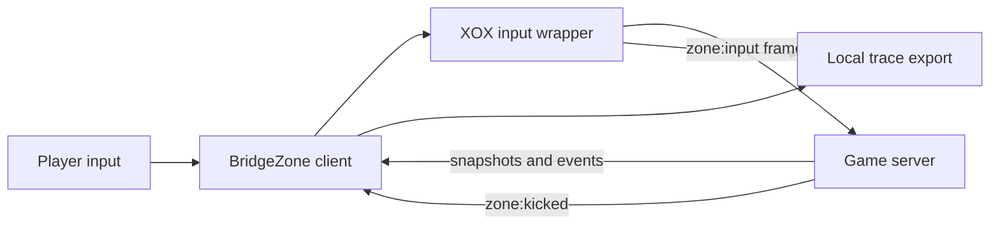

# Findings and evidence

This document records what the saved BridgeZone client traces show. It separates
local tests, browser-side observations, and events confirmed by the game server.
The results are from private bot matches on 2026-10-08 and 2026-10-15; they do
not establish behavior in every match or a general anti-cheat bypass.

## System boundary



The public client exposes input submission, prediction, rendering, snapshots,
and the handling of a `zone:kicked` event. The server decides whether to accept
shots or remove a player. Its detector and authoritative physics source were
not delivered to the browser and are not in this repository. The
[capture manifest](research/manifest.json) identifies the public client bundles
examined; the original third-party bundles remain excluded from this repository.

## Evidence index

Server counts below come from the saved `serverEvents` arrays, except for the
1.4.0 summary. A missing kick means none was recorded before that particular
trace ended, not that the server would never kick.

| Receipt | Version | Server events | Recorded outcome |
| --- | --- | --- | --- |
| [Summary](verification/live-result.json) | 1.4.0 | 11 shots, 4 hits, 54.6 damage | Removed for detected aim assistance; no raw event transcript |
| No JSON trace | 1.5.1 | Authoritative counters unavailable | Removed in a private 9-bot match; screenshot retained locally |
| [Trace](verification/live-trace-v1.5.3-2026-10-15.json) | 1.5.3 | 44 shots, 8 hits, 1 kill, 190.6 damage | `kicked`: aim assistance detected |
| [First trace](verification/live-trace-v1.5.4-2026-10-15.json) | 1.5.4 | 19 shots, 13 hits, 2 kills, 198.8 damage | No recorded kick before bot elimination |
| [Second trace](verification/live-trace-v1.5.4-active-2026-10-15.json) | 1.5.4 | 51 shots, 14 hits, 228.2 damage | No recorded kick before bot elimination |
| [Early export](verification/live-trace-v1.5.5-2026-10-15.json) and [later export](verification/live-trace-v1.5.5-25bots-2026-10-15.json) | 1.5.5 | 1 shot, 1 hit, 32 damage | Two snapshots of **one short match**, with no recorded kick |
| User-supplied export, not mirrored | 1.5.6 | 88 shots, 27 hits, 6 kills | Mixed weapons in one match; no recorded kick |
| User-supplied export, not mirrored | 1.5.8 | 0 shots, 0 hits | No outgoing Fire; 202 Rage samples held at alignment after ADS, no recorded kick |
| User-supplied export, not mirrored | 1.5.9 | 351 shots, 82 hits, 13 kills, 2295.8 damage | Mixed weapons in one match; no recorded kick |

The two 1.5.5 files share `trace.startedAt =
2026-10-15T14:33:31.561Z`, the same match counter, and the same two server
events. They must not be counted as independent trials. The first export contains
3,850 input frames and the later one contains the rolling maximum of 4,096.

### Integrity hashes

Use `shasum -a 256 verification/*.json` to compare downloaded receipts with
these SHA-256 values.

| File | SHA-256 |
| --- | --- |
| `live-trace-v1.5.3-2026-10-15.json` | `b1b3af3ffbae9e68f35b52bc183520f7e3bf142aa5bc1e4d5847a5e8d5b08a67` |
| `live-trace-v1.5.4-2026-10-15.json` | `d108d10fa95ed641231d28a50be32675afb03a6aa708834286a28e6849172371` |
| `live-trace-v1.5.4-active-2026-10-15.json` | `086b22e02bb463ada8dce29f2ebe501e5e313bfcf77fa2dedc433925f151aa69` |
| `live-trace-v1.5.5-2026-10-15.json` | `16b1d73a03af12b52e193c5e636a39a9ec84febf1822d76d160980d3dbdbde51` |
| `live-trace-v1.5.5-25bots-2026-10-15.json` | `5f19f7a7845711351b3040e0ede3f91ee868252a8a8f98857675f773870f7284` |

The user-supplied 1.5.8 export `bridgezone-trace-2026-10-15T17-58-42-665Z.json`
has SHA-256 `15e714ce62166969f4b019ff06ce114a4d505c7a44e19ee72bb2d96ad16399f8`.
It is kept in the user's Downloads folder rather than mirrored here.
The user-supplied 1.5.9 export `bridgezone-trace-2026-10-15T18-16-25-542Z.json`
has SHA-256 `dda31783653b3f8898b6cb56fcfb22d2491428b4c1cc60f3a7426611f46c1084`.
It also remains in the user's Downloads folder.

### Version 1.5.9 mixed-weapon trace

The server recorded 351 shots, 82 hits, 32 headshots, and 13 kills. This
confirms that the earlier no-fire regression was fixed in this match; it does
not establish accurate shots at every distance. The retained outgoing input
included Interact on 11 frames. Three F keydowns and three keyups were
recorded while pointer lock and input were enabled, so the F path reached the
outgoing frame. The export does not separately confirm a completed pickup.

The saved target setting was Head for the full trace. All 512 retained sent
aim decisions used the head aim point, including decisions for targets hundreds
of metres away. The new Smart Rage aim setting adapts that saved preference to
chest when either player moves quickly or the target is over 50 metres away,
and scores pitch as well as yaw when choosing a target. Version 1.5.10 has no
server trace yet, so any hit-rate improvement remains unverified.

There were 579 Rage samples classified as reload and 86 as no-ammo. Earlier
code could request ADS on a selected target while reloading or empty; 1.5.10
releases that automatic ADS request and keeps sprint available in those states.
The captured shared game physics also applies a movement slowdown while ADS
is held for an active shot. The browser client cannot make the server treat
continuous ADS as full-speed movement or grant an unlimited reserve through a
supported input. Ammo assist now requests nearby compatible ground-ammo
pickups and normal reloads, while leaving ammunition authoritative to the
server. New traces record pickup requests and server reserve changes as
separate observations.

The 1.5.9 trace had 282 outgoing Fire decisions without a local shot prediction.
Every one of those decisions recorded active weapon cooldown. Holding Fire
through cooldown is normal for automatic weapons, so the analyzer now reports
these separately from unexplained prediction gaps.

## What changed and what was observed

### Rejected aim behavior

The 1.4.0 summary recorded 11 server shots, 4 hits, and then removal. Version
1.5.1 displayed player and loot overlays in Edge but was also removed for
detected aim assistance; its authoritative counters were not saved. Version
1.5.3 has the strongest preserved rejection receipt: 44 server shots, 8 hits,
one kill, then a `kicked` connection state with the error:

> Anti-cheat removed you from this match: aim assistance was detected.

In the retained 1.5.3 input window, the original camera turned at most 14.6
degrees between adjacent frames while outgoing aim turned as far as 87.6 degrees.
Large outgoing turns often occurred on Fire and reversed on the next frame.
That is a plausible detection signal, **not proof** of the private server rule.

### Bounded turns and ammunition state

Version 1.5.4 capped outgoing turns at four degrees per input frame and held
Fire until the outgoing aim aligned. Two private 99-bot matches recorded server
hits without an anti-cheat kick before bot elimination. This is evidence of
bounded success, not of persistent acceptance or immunity to detection.

The second 1.5.4 trace contains 84 locally predicted shots but only 51
server-confirmed shots. Predictions continued after server confirmations stopped
while the client still reported a connected state. The prior local-only magazine
and reserve refill is a plausible cause of that divergence; it is not confirmed
as the server's reason. Version 1.5.5 removed that local ammo mutation and
requests a normal reload from available reserve ammo.

Version 1.5.5 raised the turn cap to eight degrees, favors targets requiring
less turning, and limits Rage fire to a weapon's useful range. Its saved match
ended too early to measure sustained accuracy or anti-cheat acceptance: the
server confirmed one shot and one hit. Local tests cover its input and prediction
paths, but no broader live conclusion follows from the short trace.

Version 1.5.6 adds automatic local build/reload while a Zone tab is open,
removes XOX's extra stealth delay when Fast fire and Rage are enabled, checks
alignment against a moving target before predicting a shot, and corrects the
average direction of multiple predicted pellets. A user-supplied 1.5.6 export
contains 88 server shots, 27 hits, six kills, no kick, and no recorded errors.
Its SHA-256 is `ea7066c1aefc4f9f2f75ebbfbaa520a5e72ebbbcc7fa3792ad625252b2daa425`.
The raw export stays outside this public repository. It covers one match with
sniper, SMG, gun, and rifle use, but records no weapon or target distance per
shot. It cannot establish accuracy by weapon or at 600 m.

In the part of the export where both a local prediction and its input frame are
retained, 18 moving predictions average 0.56 degrees of deviation from the
sampled aim and 18 stationary predictions average 0.06 degrees. For 36 server
shot events whose ticks overlap retained input frames, 10 ticks have nonzero
movement input and one same-tick hit; the other 26 have 11 same-tick hits.
Server events can be delayed relative to input, and weapon, distance, and target
movement are mixed. These figures show a problem worth testing, not a causal
hit-rate comparison.

The captured public physics bundle (SHA-256
`2027d73bd9daea6e44f954bfce014af3ee8b5df3550bec44a2b9c046b7b71b1e`)
uses `rangeEnd` as the end of damage falloff, then applies `minDamage`; it does
not use that field as a maximum hit distance. Its weapon simulation ramps ADS
over `adsSeconds` and adds movement and bloom to spread even when ADS reaches 1.
That is static client evidence, not proof that the current server uses the same
code or that arbitrary distant shots can hit.

Version 1.5.7 removes XOX's `1.35 × rangeEnd` target-selection cap and uses
the selected range up to 600 m. Rage holds ADS input before a target appears and
waits until its local ADS state reaches 0.995 before firing. Fast fire uses exact
corrected angles without XOX's added jitter. At long range it also requires
tighter alignment after a target moves. Trace exports now record target distance,
weapon ID, local ADS state, movement input, ADS request, prediction, and whether
correction and Fire were sent. These are local code and test results; no 1.5.7
server trace verifies distant hits. The server still owns shot reach, spread,
fire cadence, and hit validation. Visible camera recoil is unchanged.

Version 1.5.8 expands the bounded export to distinguish selection, sample-time
fire gating, local prediction, outgoing Fire, and server events. Each recorded
Fire decision includes the selected aim point and target velocity, local player
and weapon state, sample-to-send target movement when the sequence matches,
input and outgoing angles, and a local geometric estimate of projectile distance
from the selected point before and after correction. Rage gate counters cover
all observed samples, while detailed gate records are retained on changes and
at short intervals. Settings transitions are retained alongside match starts.
The export reports per-buffer dropped counts. Connection
errors are classified instead of exporting raw error strings. The local
`verification/analyze-trace.mjs` command groups outgoing Fire by weapon, range,
and movement and identifies missing predictions or large geometric deviations.
It keeps server events separate because the observed protocol does not provide
a guaranteed shot-to-input sequence link. These diagnostics have local test
coverage. The user-supplied 1.5.8 trace below supplies a bounded live result.

Server snapshots additionally record the authoritative input ACK, ADS, weapon,
magazine, position, and observed acknowledgement latency. The analyzer shows
which retained outgoing Fire sequences the highest observed ACK covers. An ACK
only shows that the server advanced past an input sequence; it does not prove
the server accepted Fire, produced a shot, or registered a hit. Predictor state
is captured before reconciliation and can temporarily disagree with the server
because of network delay.

The hash-matched captured client chunk `0ozbivb7uobj6.js` (SHA-256
`96f29cd0a2b7229b750d4d9220150cddd595a333e0601566e290efa73b166d5a`)
derives active weapon stats from `slots[active].weapon` and its rarity. The new
weapon ID field therefore reads the active slot first and reports its source;
it falls back to a stats ID if the slot is unavailable. The same captured
snapshot path uses `me.ack` and `sentAt` to update its RTT estimate, supporting
the input acknowledgement and latency fields above. This is static evidence
for the captured client; the 1.5.8 trace contains slot weapon IDs and input ACKs.

### The 1.5.8 no-fire trace and the 1.5.9 fix

The user-supplied format-v2 trace recorded 1,338 outgoing frames, 789 server
snapshots observed, no outgoing Fire, no local shot prediction, and no server
shot event. Rage gate counters show 1,131 unplayable samples, five ADS ramp
samples, and 202 alignment holds. Many unplayable samples occurred during the
pre-ground or dead phases. Once on the ground, selected target distances in the
retained gates ranged from 53.18 to 89.2 m. Two retained gate rows show a manual
Fire press entering the hook and being removed before prediction. The trace
contains no Interact bit, which does not prove whether F/E was pressed: it has
no raw keyboard events and the panel could have lost pointer lock.

Source inspection found that Rage's pre-prediction hold required its previous
outgoing angle to satisfy a tight tolerance against a freshly sampled moving
target. The outgoing rewrite could aim at that fresh position but never saw a
Fire request. Version 1.5.9 allows a shot into prediction when the selected
target is reachable within one bounded outgoing turn. The outgoing rewrite
still checks current alignment and suppresses Fire if the turn is incomplete.
Tests cover a moving target at long range, a large sudden target change, and
the final outgoing safety check. No 1.5.9 server match has been recorded yet.

Captured client controls map F/E to Interact bit 64 and require pointer lock.
Version 1.5.9 passes an interaction frame through using the player's real view,
stops automatic fire and reload during that press, and lets F/E keys leave the
panel. The panel's Resume button requests pointer lock after settings changes.
Loot vision now includes nearby ammo and prioritizes the active weapon's ammo.
New bounded trace fields distinguish sampled and sent buttons and record only
F/E and pointer-lock state, so the next export can locate an interaction loss
without recording unrelated keyboard input.

The captured movement simulation reduces speed while ADS is held and disables
sprint. Version 1.5.9 releases automatic ADS when there is no selected target,
allowing normal travel and sprint between engagements. Full-speed movement
while continuously scoped is not supported by the captured movement model.
The captured ammo reserve has finite caps and snapshots reconcile ammo state;
auto reload requests a real reload when reserve exists. A client-only ammo
counter change cannot establish infinite ammunition on the server. These
mechanics were captured on 2026-10-08 and may differ from the current server.

### Local display and movement limits

The client predicts a shot locally before an outgoing input frame may be
rewritten. A visible tracer can therefore follow the original camera while the
server receives a different aim angle. Server-confirmed shot and hit events are
the deciding evidence. Spread inversion is covered by a local single-projectile
test, but lag and reconciliation can change authoritative shot state. Shotgun
pellets cannot all be corrected with one direction, and cover can still block
shots.

Physical fly or underground hover is not implemented. The observed input frames
have no position or velocity setter, server snapshots restore authoritative
positions, and the shared raycaster rejects below-terrain shot origins. A real
new movement mode would require the owner's server and physics source.

## Reproduce the local checks

```sh
./extension/build-extension.sh
node --check bridgezone-tools.user.js
node --check extension/loader.js
node --check extension/bridgezone-main.js
node --test tests/*.test.cjs
```

The 2026-10-15 portable 1.5.9 run passed 67 tests with three optional tests
skipped. One optional test can use the hash-matched captured physics bundle;
two need the captured runtime. The JSON traces contain allowlisted game-state
diagnostics, no session token or match ID, and cannot reveal an unshipped server
detector. The panel's **Save trace** button exports the current in-memory
buffers; save them before leaving a match. The analyzer reads both format v1
and v2 exports without treating local geometric estimates as server hits.

## Publication choices

All original project code and JSON findings are in XOX. The 39 captured
third-party JavaScript bundles are described by [URLs and hashes](research/manifest.json)
but are not republished. Raw PNG screenshots are also excluded because the
archive contains browser context and at least one private lobby invite URL.
Some older observations are therefore summarized without a public screenshot.
